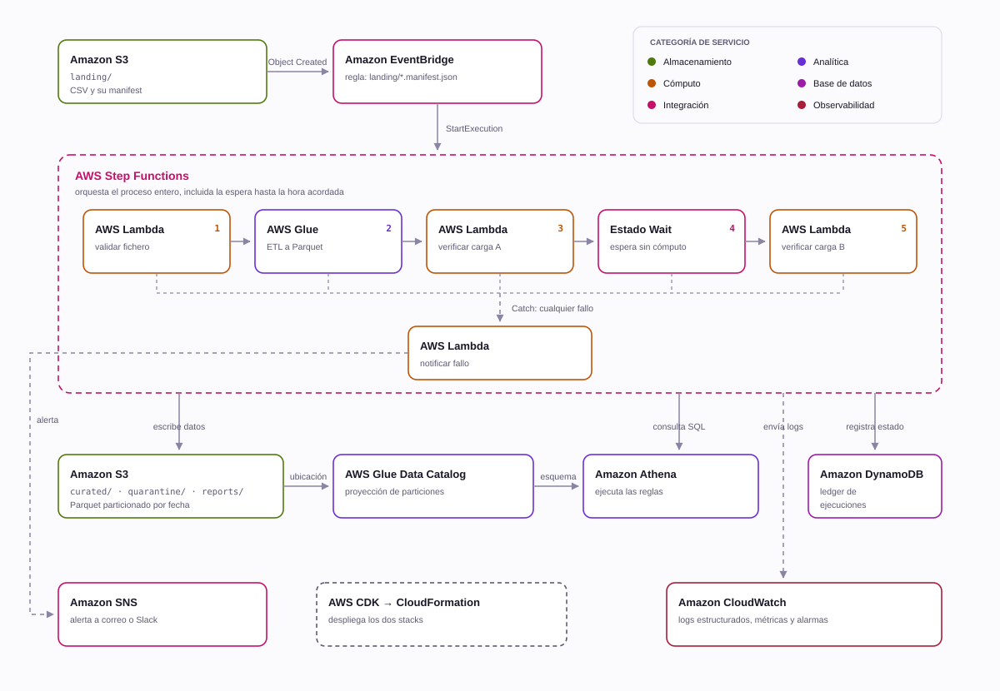

# Pipeline de ingesta y doble verificación en AWS

Automatiza de principio a fin una tarea que hasta ahora era manual: subir un CSV,
lanzar el job que lo carga, comprobar que los datos están, y volver a comprobar
más tarde que siguen estando bien.

Todo serverless, sin un solo servidor que mantener: **S3 + EventBridge + Step
Functions + Lambda + Glue + Athena + DynamoDB + SNS**, desplegado con **AWS CDK
(Python)**. Incluye una demo local con LocalStack para probarlo entero sin
cuenta de AWS.

<p align="center">
  <picture>
    <source media="(prefers-color-scheme: dark)" srcset="docs/aws-architecture-dark.svg">
    
  </picture>
</p>

<p align="center"><sub>El diagrama se genera con <code>make diagram</code>, así que no se queda desfasado respecto a la arquitectura.</sub></p>

## El problema

El proceso manual tenía cuatro pasos y tres puntos ciegos:

| Paso manual | Qué falla | Qué lo sustituye |
| --- | --- | --- |
| Subir el CSV a la herramienta | Nadie comprueba que el fichero esté completo | Manifest con checksum y número de filas, validado antes de gastar un céntimo en cómputo |
| Lanzar el job de carga | Depende de que alguien se acuerde | EventBridge dispara al aparecer el manifest |
| Comprobar que los datos están | Se mira "a ojo", sin criterio escrito | 12 comprobaciones declarativas en SQL, con severidad crítica o de aviso |
| Volver a comprobar tras la hora programada | Detecta que faltan filas, pero no que **alguien las cambió** | Huella de la partición en la fase A, comparada en la fase B |

Ese último punto es el que más me interesaba. Contar filas dos veces no
detecta un reproceso que borra la partición y la vuelve a escribir con otro
contenido: el conteo puede cuadrar igual. Comparar una huella
(filas + suma de importes + claves distintas) sí lo detecta.

## Cómo funciona

### 1. Contrato antes que datos

Cada CSV llega acompañado de un `manifest.json`:

```json
{
  "dataset": "clientes",
  "business_date": "2026-08-27",
  "row_count": 200,
  "sha256": "c82c2a37413d…",
  "delimiter": ",",
  "columns": ["cliente_id", "nombre", "email", "…"]
}
```

El pipeline se dispara con la llegada del **manifest**, no del CSV. Como el
manifest se sube el último, su aparición garantiza que el fichero de datos ya
está completo en S3.

La Lambda de validación comprueba checksum, número de filas y cabecera **antes**
de arrancar Glue. Si algo no cuadra, el fichero se mueve a `quarantine/` con un
`.motivo.txt` al lado y se avisa. El clúster no llega a levantarse.

### 2. Las reglas viven en YAML, no en el código

```yaml
datasets:
  clientes:
    primary_key: [cliente_id]
    numeric_columns: [importe_total]
    checks:
      - { id: filas_vs_manifest, type: row_count }
      - { id: clave_primaria_unica, type: unique, columns: [cliente_id] }
      - { id: pais_en_dominio, type: accepted_values, column: pais,
          values: [ES, PT, FR, IT, DE, NL, BE] }
      - { id: importe_no_negativo, type: expression, expression: "importe_total >= 0" }
      - { id: email_con_arroba, type: expression, expression: "email LIKE '%@%.%'",
          severity: warning }
```

Cada regla se compila a una sentencia SQL que devuelve una sola cifra. Añadir
una comprobación es un cambio de configuración revisable en un pull request, no
un despliegue de lógica.

El mismo YAML alimenta al motor de reglas **y** al catálogo de Glue: las tablas
se crean desde el contrato, así que el esquema declarado y el catalogado no
pueden desincronizarse.

### 3. Dos verificaciones, un solo código

```
VerificarCargaA  ─ justo tras la carga ─┐
                                        ├─ mismas reglas, mismo handler,
VerificarCargaB  ─ pasada la hora     ─┘   cambia solo el parámetro `phase`
```

La fase A guarda en DynamoDB la huella de la partición. La fase B la recalcula y
las compara. Si entre medias alguien reprocesó, se ve:

```
DriftDetected: los datos cambiaron tras la carga:
  row_count 200 -> 400; numeric_checksum 508395.11 -> 1016790.22
```

La espera entre ambas es un estado `Wait` de Step Functions con timestamp
absoluto: **no consume cómputo**, así que esperar seis horas cuesta cero.

### 4. Nada se pierde

Cada ejecución deja un registro en DynamoDB (`run_id`, fichero, filas
esperadas y escritas, huellas, reglas incumplidas, estado final) y un informe
en S3 en JSON y en Markdown. Sustituye al "sí, lo miré esta mañana".

## Decisiones que merecen explicación

**Partition projection en lugar de crawler.** Athena calcula las particiones a
partir del patrón de la ruta. No hay que ejecutar `MSCK REPAIR`, no se paga un
crawler, y —lo importante— una partición nunca queda sin registrar justo cuando
se va a verificar.

**Sobrescritura dinámica de partición.** El job escribe con
`partitionOverwriteMode=dynamic`, así que reejecutarlo deja la partición como si
fuese la primera vez. Reprocesar no duplica.

**Límite de bytes escaneados en el workgroup de Athena.** 1 GB por consulta. Con
el particionado bien hecho una verificación escanea unos pocos MB; el límite está
para que un error no se lleve la factura por delante.

**Lambdas en ARM64.** Mismo código, ~20 % menos de coste.

**Checksum y conteo en streaming.** Un fichero de Datamap puede pasar del
gigabyte; la Lambda nunca lo carga entero en memoria.

**Esquema explícito, nunca inferido.** La inferencia hace que el mismo fichero se
cargue distinto según el día. El esquema sale del contrato.

## Pruébalo sin cuenta de AWS

```bash
make install     # dependencias
make up          # LocalStack + recursos (S3, DynamoDB, SNS)
make demo        # pipeline completo: termina en VERIFIED
```

Y los tres caminos de error:

```bash
make demo-ko     # manifest que no cuadra  → quarantine/
make demo-drift  # reproceso entre A y B   → DriftDetected
python local/run_pipeline.py --file sample_data/clientes_sucio.csv
                 # PK duplicada, país fuera de dominio, importe negativo
```

Salida real de `make demo-drift`:

```
[5] VerificarCargaB: comprobacion diferida y comparacion de huella
------------------------------------------------------------------------
[99] La maquina de estados entra en el Catch: DriftDetected
  motivo: los datos cambiaron tras la carga:
          row_count 200 -> 400; numeric_checksum 508395.11 -> 1016790.22

RESUMEN DEL LEDGER (DynamoDB)
  status           DRIFT_DETECTED
  fingerprint_a    {'row_count': 200, 'numeric_checksum': 508395.11, ...}
  fingerprint_b    {'row_count': 400, 'numeric_checksum': 1016790.22, ...}
```

En local, Glue y Athena se sustituyen por DuckDB, que ejecuta **el mismo SQL**
generado por las mismas reglas. El resto —S3, DynamoDB, SNS, validaciones,
ledger, informes— es exactamente el código que se despliega.

## Desplegar en AWS

```bash
make package                       # empaqueta las Lambdas
cd infra && cdk bootstrap          # solo la primera vez en la cuenta
make deploy
```

Y ya se puede lanzar una carga:

```bash
aws s3 cp clientes.csv           s3://<bucket>/landing/dataset=clientes/dt=2026-08-27/
aws s3 cp clientes.manifest.json s3://<bucket>/landing/dataset=clientes/dt=2026-08-27/
```

Configuración en `infra/cdk.json`:

```json
{
  "context": {
    "env": "dev",
    "business_timezone": "Europe/Madrid",
    "verify_b_schedule": "08:00",
    "alert_emails": ["datos@ejemplo.com"]
  }
}
```

## Estructura

```
src/
  common/      manifest, reglas, ledger, S3, alertas, configuración
  engines/     QueryEngine → AthenaEngine (AWS) | DuckDBEngine (local)
  handlers/    las 4 Lambdas: validar, verificar, programar, notificar
  glue_jobs/   ETL PySpark landing → curated
  transform/   equivalente local del ETL, con las mismas reglas
infra/         CDK: DataPlatformStack + IngestPipelineStack
rules/         checks.yaml — el contrato de datos
local/         docker-compose, bootstrap y runner de la demo
tests/         89 tests · 96 % de cobertura
```

El truco de diseño está en `engines/`: la lógica de verificación depende de la
interfaz `QueryEngine`, no de Athena. Por eso el mismo código se prueba en
milisegundos con DuckDB y se ejecuta en producción contra Athena.

## Calidad

```bash
make test     # 89 tests, sin necesidad de AWS (moto + DuckDB)
make lint     # ruff
make synth    # valida que la infraestructura sintetiza
```

La CI ejecuta las cuatro cosas en cada push, incluida la demo completa contra
LocalStack: los cuatro caminos (correcto, fichero corrupto, datos sucios y
reproceso) se verifican en cada commit.

## Coste aproximado

Una carga diaria de un fichero de ~100 MB:

| Servicio | Uso | Coste mensual |
| --- | --- | --- |
| Step Functions | 8 transiciones × 30 | < 0,01 $ |
| Lambda | 4 invocaciones × 30, ARM64 | < 0,01 $ |
| Glue | 2 DPU × 3 min × 30 | ~0,45 $ |
| Athena | ~30 consultas × pocos MB | < 0,01 $ |
| S3 + DynamoDB + SNS | almacenamiento y escrituras | ~0,50 $ |

Menos de un euro al mes. El estado `Wait` de seis horas no cuesta nada.

## Licencia

MIT
